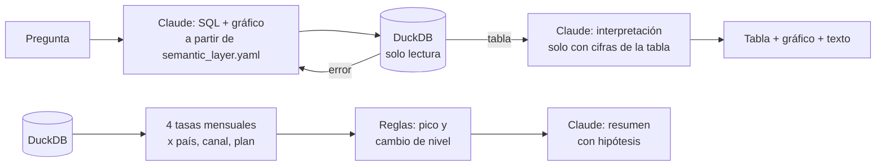

# Analista de autoservicio con IA para un SaaS contable

Prototipo de analítica con LLMs para un SaaS contable y financiero para pymes en LATAM
(5.000 pymes sintéticas, 8 países, enero 2024 – agosto 2026). Hace tres cosas:

1. **Responde preguntas de negocio en lenguaje natural.** Un agente escribe SQL a partir
   de una capa semántica, lo ejecuta en DuckDB, corrige su propio SQL si falla y
   responde con una tabla, un gráfico y una interpretación.
2. **Detecta anomalías automáticamente** en churn, cobros y conversión, por país, canal y
   plan. Claude redacta un resumen del periodo con hipótesis de causa.
3. **Está evaluado.** Con un set de preguntas con respuesta correcta y anomalías
   inyectadas en los datos como ground truth (metodología en [Evaluación](#evaluación)).

> Todos los datos son ficticios y no representan a ninguna empresa real.

## Cómo funciona



### Capa semántica: la única fuente de verdad

[`semantic_layer.yaml`](semantic_layer.yaml) describe las tablas, las relaciones, 13
métricas (definición, SQL base, cómo leerla, sinónimos y dueño) y las reglas del agente.
El agente parte de ahí y no inventa definiciones. Por ejemplo, "churn" siempre se separa
en voluntario e involuntario, y una tasa calculada sobre menos de 50 clientes lleva
advertencia.

### Agente text-to-SQL ([`src/agent.py`](src/agent.py))

- **Salidas estructuradas (JSON schema):** Claude devuelve SQL, métrica base, supuestos y
  la propuesta de gráfico en un formato fijo, sin parsear texto libre.
- **Autocorrección:** si DuckDB da error, se lo manda a Claude para que corrija el SQL,
  hasta 2 veces.
- **Seguridad:** la conexión es de solo lectura, se acepta una sola sentencia
  `SELECT`/`WITH` y se rechaza cualquier escritura antes de ejecutar.
- **Interpretación anclada a los datos:** las cifras derivadas (participaciones,
  variaciones) se calculan en el SQL, no de cabeza. El texto solo puede citar cifras que
  estén en el resultado.
- **Caché de prompt:** la capa semántica se cachea entre llamadas.

### Detector de anomalías ([`src/anomalies.py`](src/anomalies.py))

Monitorea 4 tasas (fallo de pagos, churn voluntario, churn involuntario y conversión
trial → pago), en total y por país, canal y plan: 58 series por mes.

- **Pico:** el mes contra los 6 anteriores, con |z| ≥ 3. Como los segmentos son chicos
  (53 a 251 clientes por país), la desviación estándar tiene un piso binomial: una
  variación esperable por tamaño de muestra no se marca.
- **Cambio de nivel:** los últimos 3 meses juntos contra los 6 anteriores (test de dos
  proporciones). Detecta caídas graduales que mes a mes quedan dentro del ruido.
- **Materialidad:** solo alerta si hay al menos 5 eventos de diferencia con lo esperado.
- **Resumen con Claude:** agrupa las alertas que tienen una misma causa (un problema de
  un país aparece también en el total, en los planes y en los canales), las ordena por
  impacto, propone hipótesis y sugiere cómo verificarlas. Recibe cuántas series se
  evaluaron, para no sobrerreaccionar a alertas aisladas que pueden ser azar.

Los resúmenes de ene, mar y jun 2026 vienen generados en [`reports/`](reports/), así la
pestaña Alertas los muestra sin llamar a la API.

## Cómo correrlo

Requiere Python 3.11+ y una API key de Anthropic.

```powershell
py -3.12 -m venv .venv
.venv\Scripts\Activate.ps1          # en macOS/Linux: source .venv/bin/activate
python -m pip install -r requirements.txt
copy .env.example .env              # y pega tu ANTHROPIC_API_KEY
streamlit run app.py                # abrir http://localhost:8501
```

Los datos ya vienen en [`data/`](data/): la base `saas.duckdb` que usa la app y una copia de
cada tabla en CSV.

La app tiene tres pestañas: **Pregunta** (chat con el agente), **Alertas** (detector y
resumen de Claude por periodo) y **Métricas** (la capa semántica). Las pestañas Alertas y
Métricas funcionan sin API key; los resúmenes de ene, mar y jun 2026 ya vienen generados.

Cada parte también corre sola desde la terminal:

```powershell
python src\agent.py "¿Cómo evolucionó el churn voluntario de México en 2026?"
python src\anomalies.py --month 2026-03     # alertas + resumen de Claude
python src\anomalies.py --all               # todas las alertas, sin LLM
```

El modelo por defecto es `claude-opus-5`; se puede cambiar con `CLAUDE_MODEL` en `.env`.

## Evaluación

**Agente.** Un set de preguntas de negocio (métricas simples, cortes por país y plan,
cohortes, NRR, comparaciones entre años, rankings, y algunas sin datos como NPS o CAC que
el agente debe rechazar) se compara contra un SQL de referencia escrito a mano, sin copiar
la capa semántica. Se compara por valores, con tolerancia, así que no importa cómo se
llamen las columnas.

Además, un **juez** (Claude, con acceso a la capa semántica) revisa si la interpretación
afirma algo que la tabla no respalda. Para mejorar el prompt de interpretación se usó un
set aparte de preguntas de desarrollo, así el set de prueba no se ajusta a sí mismo.

**Detector.** Los datos de `data/` traen anomalías inyectadas al generarlos (un salto de
fallo de pagos en un país y mes concretos, un pico de churn voluntario en otro país y mes,
y una caída sostenida de conversión en un canal). Ni el agente ni el detector reciben esa
información: se puede correr `python src/anomalies.py --all` y comprobar si las marca.

Los scripts de evaluación y sus resultados no se incluyen en este repositorio.

## Limitaciones

- **El detector se ajustó después de un fallo:** la regla de cambio de nivel se agregó
  al ver que la primera versión, solo con z-score mensual, no detectaba una de las
  anomalías inyectadas (una caída gradual de conversión). Es un método estándar para
  cambios graduales, pero la detección no fue una medición a ciegas.
- **Muestra chica:** el set de preguntas de evaluación es pequeño, así que un buen
  resultado ahí es compatible con una precisión real menor en preguntas distintas.
- **El juez también es un LLM** y puede tener sus propios falsos positivos al revisar las
  interpretaciones.
- **Grano mensual, no semanal:** por semana hay muy pocos eventos por segmento (unos 13
  cobros semanales en un país chico) y el ruido tapa la señal.
- **Datos sintéticos y limpios:** en datos reales habría que sumar calidad de datos,
  permisos por usuario y definiciones que cambian en el tiempo.

## Estructura

```
data/                    base DuckDB y tablas en CSV (datos sintéticos)
semantic_layer.yaml      tablas, 13 métricas, reglas del agente
src/agent.py             agente text-to-SQL
src/anomalies.py         detector + resumen con Claude
reports/                 resúmenes de alertas ya generados
app.py                   app Streamlit (pestañas Pregunta, Alertas y Métricas)
assets/style.css         estilos de la app
.streamlit/config.toml   tema de Streamlit
```

## Stack

Python · DuckDB · pandas · Claude (Anthropic API, salidas estructuradas y caché de prompt) ·
Streamlit · Plotly (app) · matplotlib (gráficos desde la terminal)
